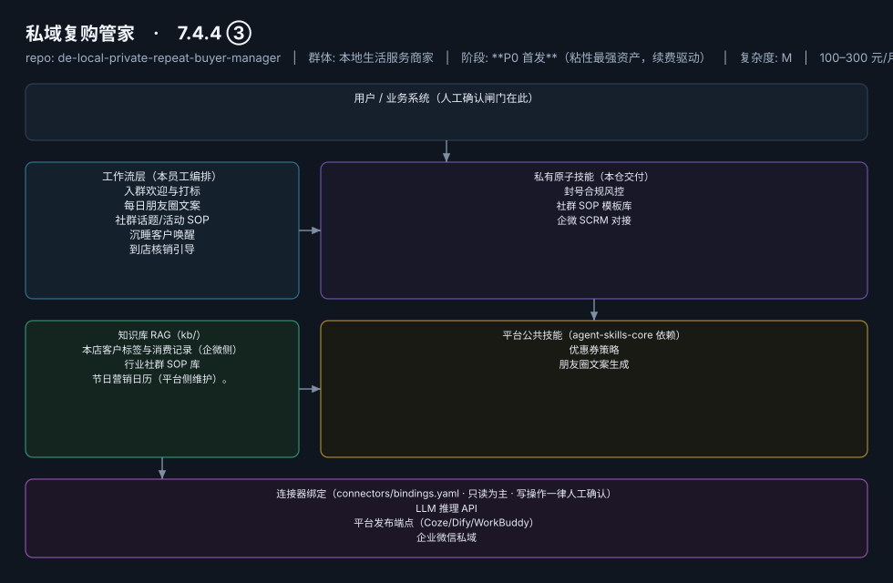
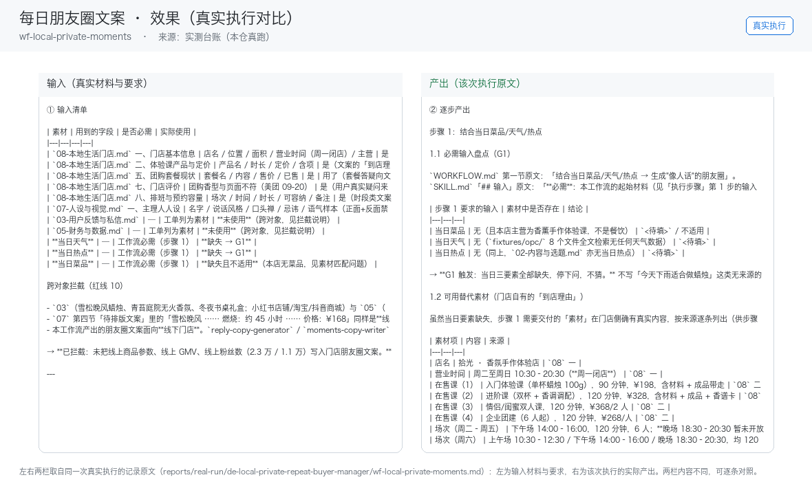

# 私域复购管家

> 让 80% 沉睡私域重新到店的"AI 店长助理"
>
> **7.4.4 ③**　·　本地生活服务商家　·　阶段 **P0 首发**（粘性最强资产，续费驱动）　·　
> 复杂度 M　·　100–300 元/月（SCRM 入门版 3980 元/年已被市场验证，据 R4 调研）；**代配置服务加成：500–1000 元/次**（企微开通代办+历史客户导入打标+首月内容陪跑——这是本群体数字化门槛最高的环节，代配置几乎是必选项）　·　定义卡 7.4.4 ③

## 演示（真实执行录播）


*真实执行回放（GIF 自动循环，非摆拍）· [▶ 观看完整版 MP4](workflows/wf-local-private-moments/docs/images/08-demo-run.mp4) · 台账见 [`reports/real-run/wf-local-private-moments.md`](reports/real-run/wf-local-private-moments.md)*



## 效果（真实执行）



*上图为**真实效果对比**，不是示意图：左栏是输入材料与要求，右栏是该次执行的产出原文，
两栏取自同一次真实执行记录。*

- 完整台账：[`reports/real-run/wf-local-private-moments.md`](reports/real-run/wf-local-private-moments.md)
- 录屏与终端回放：[`workflows/wf-local-private-moments/docs/images/`](workflows/wf-local-private-moments/docs/images/)（`08-demo-run.gif` / `08-demo-run.mp4` / `04-terminal-run.png`）
- 使用示例：[`workflows/wf-local-private-moments/docs/使用示例.md`](workflows/wf-local-private-moments/docs/使用示例.md)
> 实测判定：**通过**　·　可用度 3/5　·　编造数字 0 处　·　红线命中 1 次 / 拦截 1 次


**一句话**：已沉淀微信私域但不会运营的门店（68% 运营能力断层，据 R4 调研）

---

## 这个数字员工解决什么问题

云端定时生成+推送，发送动作由老板/店员一键确认（半自动起步，信任建立后放开自动度）。

| 项 | 内容 |
|---|---|
| 服务对象 | 已沉淀微信私域但不会运营的门店（68% 运营能力断层，据 R4 调研） |
| 可量化目标 | 私域内容日更率 100%；沉睡客户唤醒到店率 ≥5%；社群月均活动 ≥4 次 |
| 投入产出 | 人工 1 人最多管 200 客户（据 R4 调研），AI 辅助下管 1000+；唤醒 5% 沉睡客户即可覆盖年费 |
| 需求依据 | D21、D26、D07 |
| 分发渠道 | GitHub（必备）、**小红书**（私域教程类笔记流量大）、腾讯 WorkBuddy Skill 市场（企微生态天然契合）、千问办公 |

## 30 秒上手

```bash
git clone <本仓库地址> && cd de-local-private-repeat-buyer-manager
pip install pyyaml
python3 tests/run.py            # 先跑一遍自检，确认环境与契约都对得上
```

试用（把 `<输入>` 换成本人真实材料）：

```text
请以「私域复购管家」的身份，帮我跑「入群欢迎与打标」。
材料如下：<输入>
要求：只使用材料里出现过的数字，缺的写 <待填>；对外文案停在待确认状态。
```

详细接入见 [`docs/01-安装与接入.md`](docs/01-安装与接入.md)。

## 仓库结构

```text
de-local-private-repeat-buyer-manager/
├── employee.md            # 人读定义卡（12 主字段 + 2 扩展组，由 employee.yaml 生成）
├── employee.yaml          # 机器契约（能力清单 + 依赖锁）
├── dependencies.yaml      # 对 core 的外部依赖（含版本）
├── persona/               # 运行提示词 / 边界 / KPI
├── skills/                # 私有原子技能（3 个）
├── spec-bindings/         # 有意不公共化能力的本地绑定声明（0 个）
├── workflows/             # 本员工工作流（5 条）
├── kb/                    # 知识库 RAG 契约
├── connectors/            # 连接器绑定（只读为主，写操作人工确认）
├── docs/                  # 六类发布文档
└── tests/                 # 自动化多场景测试
```

## 私有原子技能（3）

| 技能 | slug | 复杂度 | 阶段 | 成熟度 |
|---|---|---|---|---|
| `封号合规风控` | `account-ban-risk-guard` | S | P0 | 契约完备 |
| `社群 SOP 模板库` | `community-sop-library` | S | P0 | 契约完备 |
| `企微 SCRM 对接` | `wecom-connect` | M | P0 | 已实现 |

## 平台公共技能依赖（2）

| 技能 | slug | 全平台复用员工数 |
|---|---|---|
| `优惠券策略` | `coupon-strategy` | 1 |
| `朋友圈文案生成` | `moments-copy-writer` | 2 |

> 这些技能来自 `agent-skills-core@1.0.0`，本仓库**只引用不复制**。

## Spec 绑定层（0）

（无）

> 这一族能力**有意不公共化**（与外部平台接口强绑定）。本仓不存正文，
> 只留本地绑定声明与连接器配置。

## 工作流（5）

| 工作流 | slug | 触发 | 阶段 | 调用技能数 |
|---|---|---|---|---|
| `入群欢迎与打标` | `wf-local-private-join-tag` | 事件（客户扫码入群） | P0 | 1 |
| `每日朋友圈文案` | `wf-local-private-moments` | 定时（每日 7:30 推送 3 条候选） | P0 | 1 |
| `社群话题/活动 SOP` | `wf-local-private-sop` | 定时（每周一推送本周 SOP） | P0 | 1 |
| `沉睡客户唤醒` | `wf-local-private-wakeup` | 定时（每周扫描） | P1 | 1 |
| `到店核销引导` | `wf-local-private-verify` | 事件（领券后 48h 未到店） | P1 | 2 |

## 知识库与连接器

- 知识库语料：['本店客户标签与消费记录（企微侧）', '行业社群 SOP 库', '节日营销日历（平台侧维护）。']
- 连接器：LLM 推理 API、平台发布端点（Coze/Dify/WorkBuddy）、企业微信私域

## 质量与验收

| 项 | 值 |
|---|---|
| 技能文件数 | 197 |
| 多场景用例数 | 225 |
| 用例通过 | 225 |
| 验收结论 | ✅ 通过 |

完整报告：[`docs/05-验收与测试.md`](docs/05-验收与测试.md)

## 许可

专有许可，详见 [`LICENSE`](LICENSE)。
