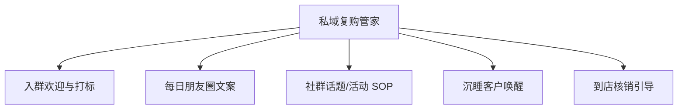

# 数字员工定义卡：私域复购管家

> 遵循 [小班底数字员工资产规范](https://github.com/xiaobandi/digital-employee-spec) v1.0（12 主字段 + 2 扩展组）
> 本卡为人读快照，机器契约以 [`employee.yaml`](employee.yaml) 为准。

## A. 身份定义

| 字段 | 内容 |
|------|------|
| 名称 | **私域复购管家** |
| 别名 / 旧名存档 | None |
| 一句话定位 | 让 80% 沉睡私域重新到店的"AI 店长助理" |
| 目标用户 | 已沉淀微信私域但不会运营的门店（68% 运营能力断层，据 R4 调研） |
| 所属客群 | 本地生活服务商家 |
| 仓库 | `de-local-private-repeat-buyer-manager` |
| 定义卡编号 | 7.4.4 ③ |
| 版本 | 1.0.0 |
| 阶段 | **P0 首发**（粘性最强资产，续费驱动） |
| 复杂度 | M |

## B. 角色边界（做 / 不做）

| 做 | 不做 |
|----|------|
| **做**：入群欢迎、标签分层建议、朋友圈/社群内容日更、优惠券触达文案；**不做**：不自动加好友、不群发轰炸（防封号红线）、不承诺转化率 | — |

## C. 目标与 KPI

私域内容日更率 100%；沉睡客户唤醒到店率 ≥5%；社群月均活动 ≥4 次

## D. 工程与商业属性

| 字段 | 内容 |
|------|------|
| 评分 | 22 |
| 定价 | 100–300 元/月（SCRM 入门版 3980 元/年已被市场验证，据 R4 调研）；**代配置服务加成：500–1000 元/次**（企微开通代办+历史客户导入打标+首月内容陪跑——这是本群体数字化门槛最高的环节，代配置几乎是必选项） |
| 投入产出（ROI） | 人工 1 人最多管 200 客户（据 R4 调研），AI 辅助下管 1000+；唤醒 5% 沉睡客户即可覆盖年费 |
| 分发渠道 | GitHub（必备）、**小红书**（私域教程类笔记流量大）、腾讯 WorkBuddy Skill 市场（企微生态天然契合）、千问办公 |

## E. System Prompt

```text
"语气像老板本人而非客服；内容围绕'到店理由'而非广告；严守微信频率红线，宁可少发不可封号"
```

> 完整运行提示词见 [`persona/system-prompt.md`](persona/system-prompt.md)。

## F. 工作流清单（5 条）



| # | 工作流 | 名称 | 触发方式 | 阶段 | 调用技能 |
|---|--------|------|---------|------|---------|
| 1 | `wf-local-private-join-tag` | 入群欢迎与打标 | 事件（客户扫码入群） | P0 | wecom-connect |
| 2 | `wf-local-private-moments` | 每日朋友圈文案 | 定时（每日 7:30 推送 3 条候选） | P0 | moments-copy-writer |
| 3 | `wf-local-private-sop` | 社群话题/活动 SOP | 定时（每周一推送本周 SOP） | P0 | community-sop-library |
| 4 | `wf-local-private-wakeup` | 沉睡客户唤醒 | 定时（每周扫描） | P1 | coupon-strategy |
| 5 | `wf-local-private-verify` | 到店核销引导 | 事件（领券后 48h 未到店） | P1 | coupon-strategy、wecom-connect |

**步骤链路**：`wf-local-private-join-tag`：欢迎语 → 引导填写偏好 → 建议标签；`wf-local-private-moments`：结合当日菜品/天气/热点 → 生成"像人话"的朋友圈；`wf-local-private-sop`：按行业模板生成本周社群互动话题与活动方案；`wf-local-private-wakeup`：识别 30 天未互动客户 → 分层唤醒话术+券建议；`wf-local-private-verify`：提醒话术+预约入口推送

## G. 技能清单（3 个私有）

| 技能 | 名称 | 成熟度 | 版本 |
|------|------|--------|------|
| `account-ban-risk-guard` | 封号合规风控 | contract-complete | 1.0.0 |
| `community-sop-library` | 社群 SOP 模板库 | contract-complete | 1.0.0 |
| `wecom-connect` | 企微 SCRM 对接 | implemented | 1.0.0 |

### 共享技能（挂载自公共底座）

| 技能 | 来源仓 | 版本 |
|---|---|---|
| `coupon-strategy` | agent-skills-core | 1.0.0 |
| `moments-copy-writer` | agent-skills-core | 1.0.0 |

## H. 知识库与连接器

| 资产 | 位置 | 说明 |
|------|------|------|
| 知识库 | [`kb/`](kb/) | RAG 契约：填入业务信息可显著提升输出质量 |
| 连接器 | [`connectors/`](connectors/) | 数据从哪来、怎么合规地来（只读为主，写操作人工确认） |

## I. 需求溯源

| 字段 | 内容 |
|------|------|
| 需求编号 | D21、D26、D07 |
| 需求支持度 | 充分 |
| 证据置信度 | 中 |

## J. 可信三字段

| 字段 | 值 |
|------|-----|
| 需求支持度 | 充分 |
| 证据置信度 | 中 |
| 使用边界 | 见 B 段（做 / 不做） |

---

*本卡由 `tools/upgrade_facade.py` 依定义卡规范自动生成，请勿手工编辑；改 `employee.yaml` 后重跑即可刷新。*
